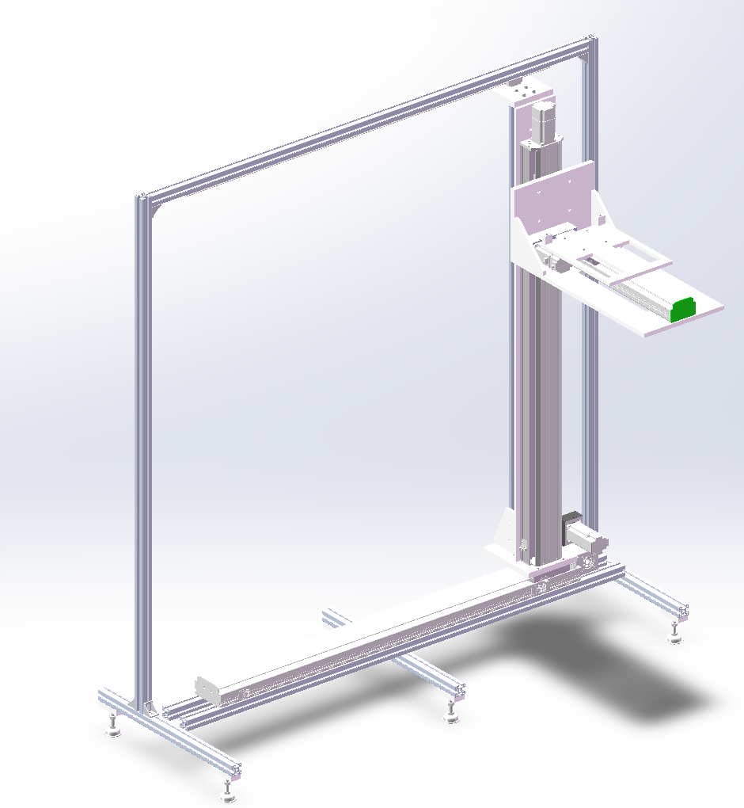

# 立式货架取货机

> 沿货架行走、升降并伸出货叉取放料箱的三轴取货机构（X 同步带 + Y 丝杆升降 + 货叉伸缩）

## 项目效果图

## 项目内容
- `b-Module-SW/`：SolidWorks 模型。总装 `LSQH-01-00 立式货架取货机.SLDASM`，加工件 `LSQH-01-01` ~ `LSQH-01-10`（含工程图），外购件模型在 `外购件/`
- `b-Office/设计说明.md`：参数、结构、零件清单与设计注意事项
- `b-Picture/`：效果图

## 保留内容

### logo与作者

- 作者：pinavia
- 

### 学习许可与权利保留

- 本项目允许个人、学校和研究者进行非商业性的学习、研究和引用。
- 未经著作权人书面许可，不得将项目内容用于商业开发、产品制造、商业服务、商业宣传、投标交付、毕业设计成品交付或再授权。
- 不得删除作者、来源、版本历史和第三方许可证声明，不得将本项目或其衍生成果宣称为与作者无关的原创项目。
- 软件源码适用 [PolyForm Noncommercial 1.0.0](https://polyformproject.org/licenses/noncommercial/1.0.0/)；机械模型、PCB、原理图、图片、文档、Unity 工程和其他非软件资料适用 [CC BY-NC-ND 4.0](https://creativecommons.org/licenses/by-nc-nd/4.0/)。
- SE、SW、STEP/STP 及其他三维模型仅允许个人或学校进行非商业学习、评审和研究；未经著作权人书面许可，不得用于加工、打样、制造、销售、量产、投标、产品交付、商业宣传、改作或再授权。
- 第三方组件、模板、元件库、外购件模型和工具仍受其原始许可证约束；本声明不扩大作者对第三方内容的权利。

商业使用、产品化、公司内部长期使用、转让或排他性授权需另行取得著作权人的书面许可。